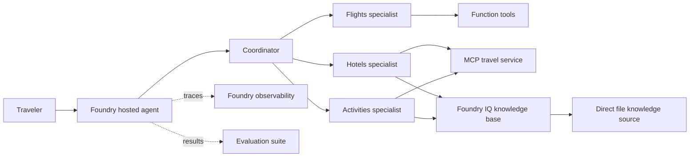

Build a four-agent travel-planning solution with Microsoft Agent Framework and
Microsoft Foundry. You will add function and MCP tools, compare local grounding
with a Foundry IQ knowledge base, deploy the workflow as a hosted agent, inspect
its distributed traces, and compare evaluation results after an instruction
change.

[](https://github.com/tmathew1000/foundry-multi-agent-developer-lab/actions/workflows/validate.yml)

> [!IMPORTANT]
> The four-hour instructional path assumes provisioning and readiness checks
> are complete before class. Follow the required path in order. Optional
> challenges do not block later modules.

## What you will accomplish

By the end of the lab, you will be able to:

* Explain the responsibilities of Microsoft Foundry and Microsoft Agent Framework
* Extend an agent with a Python function tool, a remote MCP tool, and Foundry IQ
* Compare local lexical retrieval with managed, multi-source agentic retrieval
* Coordinate four logical agents with `GroupChatBuilder`
* Expose the workflow as one hosted agent with `workflow.as_agent()`
* Follow coordinator, specialist, model, and tool calls in a Foundry trace
* Evaluate agent behavior and compare a baseline with an instruction-change candidate
* Use managed identity and environment-based configuration

## The solution you will build



Four logical Agent Framework agents run behind one Foundry hosted-agent
deployment. The coordinator routes work to specialists and synthesizes the final
itinerary.

The knowledge bootstrap uploads six bundled Markdown files directly to Azure AI
Search using a file knowledge source (preview). Students do not need a dedicated
Blob Storage account, storage network exemption, or cross-tenant storage access.
Search, model, hosting, and role-assignment prerequisites still apply. See the
[prerequisites](docs/prerequisites.md) and
[existing-environment upgrade steps](docs/troubleshooting.md#upgrade-an-existing-blob-based-environment).

## Platform responsibilities

| Microsoft Agent Framework | Microsoft Foundry |
| --------------------------- | ------------------- |
| Defines agents in code | Provides the project and model deployment |
| Registers tools and context | Hosts the containerized workflow |
| Coordinates specialist agents | Manages identity and connections |
| Builds the group-chat workflow | Collects OpenTelemetry traces |
| Exposes the workflow as an agent | Runs and compares evaluations |
| Assigns knowledge to specialists | Provides Foundry IQ lifecycle integration |

## Schedule

The four-hour session assumes each participant has completed Module 0's
provisioning, readiness checks, and live smoke test before class. Reserve a
separate setup window: initial provisioning typically takes 25 to 35 minutes,
plus authentication, checks, and any capacity or permission remediation.
Provisioning is not guaranteed to finish within that estimate. A cold-start
delivery takes longer than four hours; do not skip readiness gates to catch up.

| Module | Activity | Time |
| -------- | ---------- | -----: |
| 0 | Orient and confirm pre-provisioned readiness | 15 minutes |
| 1 | Explore and invoke the baseline agent | 30 minutes |
| 2 | Add tools and managed knowledge | 40 minutes |
| 3 | Build the four-agent workflow | 55 minutes |
| Break | Pause | 10 minutes |
| 4 | Deploy and diagnose with tracing | 35 minutes |
| 5 | Evaluate and improve | 40 minutes |
| 6 | Review and remove resources | 15 minutes |

## Start here

1. Review the [prerequisites](docs/prerequisites.md).
2. Open the repository in GitHub Codespaces.
3. Complete the setup sections in [Module 0: Orientation and preflight](docs/00-orientation.md)
   before class; revisit its architecture and readiness review during the session.

## Core and optional paths

Each module labels its work:

* Required steps form the four-hour path.
* Optional challenges extend the same concept without blocking later work.
* Checkpoint recovery restores the expected module state.

If an Azure policy, quota, or capacity restriction blocks deployment, use the
saved trace and evaluation artifacts referenced in the module. You can still
complete the diagnostic and evaluation learning outcomes.

## Cost and cleanup

Budget approximately USD 5 to USD 10 for the expected five-hour resource
lifetime. Azure AI Search, model pricing, tokens, region, indexing, retries, and
evaluation runs affect the final amount. Check current Azure pricing before
delivering the lab.

Run cleanup at the end of the lab:

```bash
azd down --purge
```

Confirm the resource group is removed before closing your Codespace.

## Repository structure

```text
docs/                 Participant and instructor guides
src/travel_buddy/     Hosted multi-agent application
src/mcp_server/       Remote travel MCP service
data/                 Grounding and evaluation datasets
scripts/              Preflight, verification, and recovery commands
checkpoints/          Known-good module solutions
tests/                Offline unit and contract tests
```

## Scope

The required path focuses on hosted agents, tools, Foundry IQ, orchestration,
tracing, and evaluation. SharePoint and OneLake knowledge sources, private
networking, CI/CD, fine-tuning, durable workflows, voice, and production-scale
operations are intentionally outside the four-hour path.

## Attribution

The lab is an original, focused learning path informed by:

* [Foundry hosted agents with Agent Framework workshop](https://github.com/Azure-Samples/foundry-hosted-agents-workshop)
* [Microsoft Foundry end-to-end agent observability workshop](https://github.com/Azure-Samples/microsoft-foundry-e2e-agent-observability-workshop)

See [Third-party notices](THIRD_PARTY_NOTICES.md) for license details.
