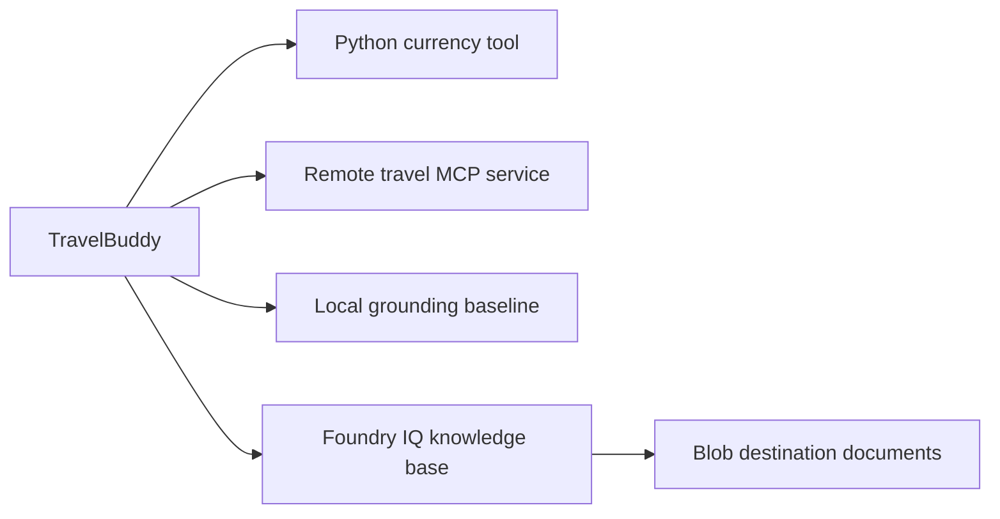

## Outcome

You will implement a function tool, inspect an MCP operation, and upgrade local
destination grounding to a shared Foundry IQ knowledge base.

Estimated time: 40 minutes.

## Architecture change



Function tools execute application code. MCP exposes remote capabilities through
a standard protocol. Foundry IQ contributes managed, multi-source knowledge with
retrieval-backed citations.

## Required: implement the currency tool

Prepare the focused starter for this module:

```bash
python scripts/start_module.py 2
```

The command replaces only `src/travel_buddy/tools.py` and reports the file it
prepared.

Open `src/travel_buddy/tools.py` and locate the TODO in `convert_currency`.

Implement these behaviors:

1. Normalize currency codes to uppercase.
2. Validate both codes against the supported-rate map.
3. Convert the source amount to USD.
4. Convert USD to the target currency.
5. Return the input, output, rate, and workshop-data notice.

> [!TIP]
> Try implementing the TODO and running the focused tests before viewing the
> solution checkpoint. If you remain blocked after five minutes, run
> `python scripts/restore_checkpoint.py 2` and compare the restored
> implementation with your attempt.

Run the focused tests:

```bash
python -m pytest tests/test_tools.py
```

Expected result:

```text
passed
```

## Required: inspect the MCP capability

Open `src/mcp_server/server.py`.

Find the operation that returns hotel and activity information. Notice:

* The schema describes arguments and results.
* The hosted agent reaches an HTTPS endpoint.
* The operation owns travel data access, not conversation orchestration.

Test its pure data layer:

```bash
python -m pytest tests/test_mcp_server.py
```

## Required: inspect the local baseline

Open `data/destinations.json`.

Compare the three capability types:

| Capability | Best for | Example |
| ------------ | ---------- | --------- |
| Function tool | Deterministic local action | Convert a known amount |
| MCP tool | Remote or reusable operation | Search lodging inventory |
| Local grounding | Application context | Read one record |
| Foundry IQ | Managed knowledge | Combine cited sources |

Open `src/travel_buddy/integrations.py` and find where destination retrieval is
constructed. Then open `src/travel_buddy/agents.py` and identify which
specialists receive that capability.

The baseline uses an Agent Framework `ContextProvider` over curated local
records. Open `src/travel_buddy/grounding.py` and find the token-overlap ranking.
Notice that the provider loads one local file, constructs citation IDs itself,
and does not plan searches across documents.

Run the baseline prompt:

```text
Recommend a Tokyo area with evening dining.
```

Record the retrieved source ID and the limitations reported by the provider.

## Required: inspect the Foundry IQ knowledge

Open `data/foundry-iq/` and compare these document categories:

* Neighborhood guidance and indicative lodging ranges
* Indoor and evening activities
* Transportation connections and trade-offs

The `azd up` post-provision hook uploaded these files to Blob Storage and created
the `travel-destinations` knowledge base. The Search service generated the
indexing pipeline for the Blob knowledge source.

Open `src/travel_buddy/foundry_iq.py` and identify:

1. Microsoft Entra token acquisition for Azure AI Search.
2. The knowledge-base retrieve request.
3. Query-planning activity and citation handling.
4. The explicit error when retrieval returns no answer.

## Required: switch to Foundry IQ

In `azure.yaml`, change:

```yaml
TRAVEL_BUDDY_GROUNDING_PROVIDER: local
```

to:

```yaml
TRAVEL_BUDDY_GROUNDING_PROVIDER: foundry_iq
```

Refresh `.env` from the deployed environment:

```bash
azd env get-values > .env
```

Add this line to `.env` for the local comparison:

```text
TRAVEL_BUDDY_GROUNDING_PROVIDER=foundry_iq
```

Restart the local host, then send:

```text
Recommend a Tokyo neighborhood under 200 EUR per night with evening dining,
convenient transportation, and a rainy-day activity. Explain the trade-offs
and cite the supporting sources.
```

Confirm that the result combines neighborhood, activity, and transit knowledge
and preserves citations.

> [!IMPORTANT]
> Foundry IQ contains curated planning guidance. Flight availability, hotel
> inventory, currency calculations, live prices, and attraction wait times
> remain tool or operational-system responsibilities.

## Required: verify behavior

Send:

```text
I have a hotel budget of 200 EUR per night for Tokyo. Convert it to JPY,
recommend an area with evening dining, and include a rainy-day activity.
```

Expected behavior:

* The currency function is called.
* The lodging operation is selected when appropriate.
* Destination guidance combines Foundry IQ sources.
* The answer retains retrieval citations.
* The answer labels workshop or mock data clearly.

## Why this matters

Giving every agent every capability increases cost, ambiguity, and attack
surface. The Hotels and Activities specialists share Foundry IQ, while Flights
continues to use deterministic functions.

## Verify your work

```bash
python scripts/verify_module.py 2
```

Expected result:

```text
PASS Module 2: function, MCP, local grounding, and Foundry IQ contracts are valid
```

## Checkpoint recovery

```bash
python scripts/restore_checkpoint.py 2
```

The restore command replaces only the workshop-owned source file for this
module.

## Optional challenge

Add a destination document, rerun `azd provision`, and verify that Foundry IQ
can answer a question that depends on the new content.

## Completion check

Continue when:

* Tool and MCP tests pass
* You can explain when to use a tool instead of Foundry IQ
* You have compared local and managed retrieval
* You have observed citations from more than one destination document
* You have observed at least one tool call

Next: [Module 3 - Build the multi-agent workflow](03-multi-agent.md).
