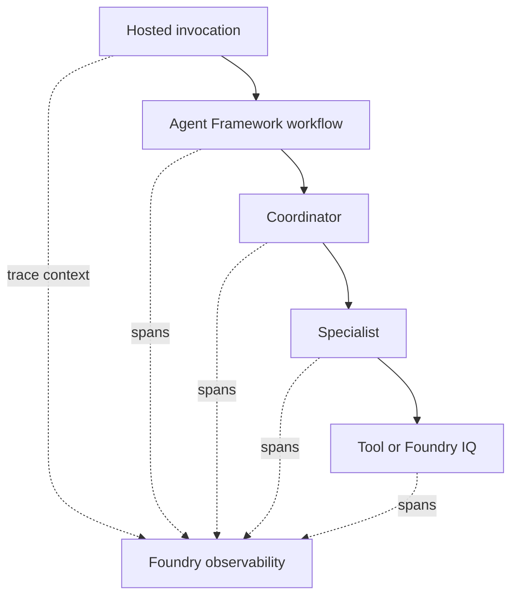

## Outcome

You will deploy the completed workflow, follow its distributed trace, and use
evidence to diagnose a controlled tool failure.

Estimated time: 35 minutes.

## Architecture change



Trace context connects the hosted request to Agent Framework, model, tool, MCP,
Foundry IQ retrieval, and citation activity.

## Required: deploy the candidate

In VS Code, select **Terminal → New Terminal**. Use the repository root (the
directory containing `azure.yaml`) as the working directory for every command
in this module. Use the same active `azd` environment you provisioned earlier.

Run the complete local verification before deployment:

```bash
python -m pytest
python scripts/verify_module.py 3
```

Deploy:

```bash
azd deploy
```

Wait until the hosted-agent status reports ready. A deployment that was accepted
but is still starting is not ready for invocation.

## Required: connect Application Insights to Foundry

The lab provisions an Application Insights resource and configures the hosted
application to export telemetry through `APPLICATIONINSIGHTS_CONNECTION_STRING`.
The Foundry project also needs a connection to that resource so you can view
traces in the portal. Creating the resource and configuring telemetry export do
not, by themselves, establish this portal connection.

Find `AZURE_APPLICATION_INSIGHTS_NAME` in your active lab environment, using the
`.env` file imported earlier in the lab. The resource name follows the pattern
`appi-mcp-<resource token>`. Despite the `mcp` name, the hosted TravelBuddy
application also exports telemetry to
this resource. Use this existing resource rather than creating a second one.

In the new Microsoft Foundry portal:

1. Open the same project that hosts your deployed TravelBuddy agent.
2. In the left navigation, select **Agents**, then select **Traces** at the top.
3. Select **Connect**.
4. Choose the subscription and resource group containing the lab's Application
   Insights resource, then select the resource matching
   `AZURE_APPLICATION_INSIGHTS_NAME`.
5. Select **Connect** and wait for the success confirmation.

If the **Connect** button is not visible, use **Manage → Project details →
Connected resources → Add connection → Application Insights**, then select the
same existing resource. If the project already has a connection, confirm that
it points to the resource named by `AZURE_APPLICATION_INSIGHTS_NAME` and used
by the application. Do not create a duplicate resource.

You need permission to add the project connection and query the selected
Application Insights resource. If access is denied, ask your administrator for
the appropriate access. Querying telemetry requires **Log Analytics Reader**.
If the underlying Log Analytics tables are protected, you may also need
**Privileged Monitoring Data Reader**.

Connecting the existing resource does not require redeploying the agent.
Generate a new invocation after connecting, as described below, and allow a few
minutes for telemetry ingestion.

See [Set up tracing in Microsoft Foundry](https://learn.microsoft.com/azure/foundry/observability/how-to/trace-agent-setup)
for the portal connection procedure and access requirements.

## Required: generate a trace

Open a VS Code terminal at the repository root (the directory containing
`azure.yaml`), using the same active `azd` environment as your deployment.
Invoke the deployed hosted agent:

<!-- markdownlint-disable MD013 -->

```bash
azd ai agent invoke travel-buddy 'Plan four days in Tokyo from Lisbon. Keep the hotel under 200 EUR per night, include a day trip, and show major prices in JPY.'
```

<!-- markdownlint-enable MD013 -->

This command targets the remote deployment in Microsoft Foundry. Do not add
`--local`, call `localhost:8088`, or use a locally connected Agent Inspector to
verify hosted-agent traces.

Local Agent Inspector testing can export application telemetry when
`APPLICATIONINSIGHTS_CONNECTION_STRING` and application instrumentation are
configured. Those local traces do not, by themselves, prove that the deployed
hosted agent is producing portal-visible traces.

Save both the **Trace ID** and **Response ID** printed by the invocation.
Use them to correlate this remote request with its portal trace.

## Required: inspect the trace

In Microsoft Foundry:

1. Open the same Foundry project that hosts your deployed TravelBuddy agent.
2. Open **Agents → Traces**.
3. Select a recent time range that includes your invocation. If an agent filter
   is available, use it to narrow the list to TravelBuddy.
4. Use the saved Trace ID to locate the invocation where the portal exposes
   trace identifiers. Open candidate traces and compare their timestamps,
   request content, and available identifiers with your invocation.
5. Check the saved Response ID in the trace details or span attributes when
   exposed. Not every portal view supports searching or filtering by both IDs.

Allow a few minutes for telemetry ingestion before refreshing the trace list.
Confirm that the time range includes the invocation and that the project is
connected to the Application Insights resource selected above.

Look for the following execution details where exposed by the configured
instrumentation and portal view. Not every item appears as a separate span,
and retrieval or citation details may appear in attributes or tool results:

* Hosted invocation
* Agent Framework workflow
* Coordinator decisions
* Selected specialists
* Model calls
* Function and MCP calls
* Foundry IQ knowledge retrieval
* Query-planning or source-retrieval activity
* Retrieved references and citations
* Final synthesis

Record:

* Which specialist ran first
* Which operation had the highest latency
* Whether an unnecessary specialist ran
* Whether Foundry IQ ran only for destination knowledge
* Which sources supported the destination recommendation
* Token usage for the complete request, when available

If an expected detail is missing, record the visibility gap rather than
assuming the operation did not run.

## Required: diagnose the controlled failure

In the same VS Code terminal at the repository root, invoke the remote hosted
agent:

<!-- markdownlint-disable MD013 -->

```bash
azd ai agent invoke travel-buddy 'Convert my Tokyo hotel budget of 200 CAD per night to JPY.'
```

<!-- markdownlint-enable MD013 -->

Save this invocation's **Trace ID** and **Response ID** separately from the
previous request. In the same Foundry project, open **Agents → Traces** and
locate this invocation using the time range and available identifiers as
described above. Allow a few minutes for ingestion, then inspect this
invocation's tool spans.

The starter currency tool intentionally supports a limited set of currencies.
Use the trace to answer:

1. Did routing select the expected specialist?
2. Did the model form valid tool arguments?
3. Did the tool execute?
4. What result or error did the tool return?
5. Did the final response represent the limitation accurately?

The correct diagnosis is based on the tool span, not on the wording of the final
answer alone.

## Why this matters

Agent responses hide execution details. Distributed tracing separates routing,
model reasoning, external dependencies, and application code so you can improve
the correct layer.

## Verify your work

```bash
python scripts/verify_module.py 4
```

Expected result:

```text
PASS Module 4: tracing configuration is present
```

The script verifies instrumentation configuration. You must inspect the live
trace to complete the learning outcome.

## Fallback artifact

If trace ingestion is delayed, open `artifacts/traces/controlled-failure.json`.
Follow the same diagnostic questions and return to the live trace if it appears.

## Optional challenge

Compare specialist span durations and propose one capability assignment that
would reduce latency without reducing answer quality.

## Completion check

Continue when:

* The candidate version is deployed
* The Foundry project is connected to the lab's Application Insights resource
* You have followed one complete trace
* You have diagnosed the unsupported-currency failure

Next: [Module 5 - Evaluate and improve](05-evaluate-improve.md).
