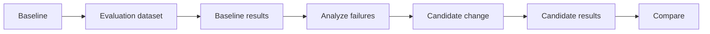

## Outcome

You will evaluate a deployed baseline, form an evidence-based hypothesis, make
one focused instruction improvement, deploy a candidate, and compare the same
suite while reviewing regressions.

Estimated time: 40 minutes.

## Architecture change



Evaluation converts agent improvement from intuition into a repeatable
measurement.

## Required: inspect the dataset

Open `evaluations/travel_buddy_cases.jsonl`. In VS Code, run every command in
this module from a terminal at the repository root, using your active lab
environment. Retain the trace IDs, response IDs, version, time, and diagnosis
collected in Module 4.

The cases cover:

* Focused requests that need one specialist
* Complete itineraries that need all specialists
* Tool selection
* Grounded recommendations
* Multi-source Foundry IQ synthesis and citations
* Supported EUR-to-JPY conversion and unsupported CAD handling
* Requests that should not trigger unnecessary tools

The suite has 12 cases, including `currency-supported`,
`currency-unsupported-cad`, `hotel-only`, and `complete-itinerary`. The hotel-only
case should not call Flights when no conversion is requested. Complete
itineraries must retain their specialist coverage and grounding behavior.

Inspect all cases and assertions before the baseline run, then keep them fixed.
Do not change required terms, forbidden terms, evaluator settings, or the
invocation-state policy between runs. The helper allows 6 to 12 cases; this
bounded suite keeps the evaluation exercise within the 40-minute module.

## Required: understand the metrics

Separate automated response checks, model-based evaluator scores, and manual
execution evidence:

| Metric | Question |
| -------- | ---------- |
| Task completion | Did the response answer the request? |
| Tool selection | Does trace evidence confirm the evaluator's assessment? |
| Tool success | What does the service evaluator report about tool execution? |
| Groundedness | Are recommendations supported by supplied context? |
| Response contract | Does the answer meet required/forbidden text checks? |
| Manual trace review | Were routing, arguments, and answer fidelity correct? |

The Foundry run uses agent and quality evaluators. The evaluation helper also
checks required and forbidden response terms deterministically. These text
checks are deliberately limited heuristics, not proof of numerical correctness
or actual tool execution. For example, the CAD case checks for `CAD` and
`unsupported` and rejects `approximately` or `rough rate`; wording can cause
false positives or negatives. Review the actual response and tool result.

`expected_agents` is expectation metadata, not observed routing or a tool-call
assertion. A response saying "CAD is unsupported" does not prove that the tool
ran. Generated results explicitly mark tool-execution evidence **unverified**.
Inspect the per-case traces manually; missing tool evidence is not a pass.
If a tool evaluator has no numeric score, comparison shows **unverified**, not
zero. A numeric judge score still does not replace trace evidence.

For `currency-supported`, check `convert_currency` and its numeric result in
the trace. For `currency-unsupported-cad`, inspect the actual path and distinguish
routing bypass, structured unsupported status, and final-response fidelity as
in Module 4. Manually review hotel-only and complete-itinerary traces too.

Compare these Foundry IQ cases:

* A Tokyo recommendation that needs neighborhood, transit, and activity sources
* A live wait-time request that the knowledge base cannot support

The candidate should preserve citations and avoid inventing live facts.

## Required: run the baseline

Before editing instructions or deploying a candidate, refresh deployment
metadata and capture the baseline:

```bash
azd env get-values > .env
python scripts/run_evaluation.py --label baseline
```

The helper targets the exact deployed agent name/version, verifies that version
exists, and records it with the evaluation/run IDs, dataset/assertion hash,
evaluator fingerprints, project, and invocation-state policy in
`.foundry/results/baseline.json`. Check the recorded version rather than
assuming a local source edit changed the deployed agent. Stale process variables
such as `FOUNDRY_AGENT_VERSION` can override refreshed `.env` values; resolve
unexpected configuration before continuing.

Evaluation uses service-managed target completions with no conversation IDs
supplied by this helper, identically for both runs. It does not invoke the CLI,
so `--new-session` and `--new-conversation` flags cannot be added to this API
request. Inspect linked per-case traces to confirm isolation and no reused
history. Without that evidence, state isolation remains unverified; do not
claim a controlled comparison. For supplementary manual probes, use the same
fresh-session/conversation policy from Module 4 for both recorded versions,
using `--version` to target each version.

Results are not overwritten. Archive an existing baseline/candidate pair before
starting a new experiment, or use the same new `--results-dir` for both runs
and comparison. Old results without provenance require a fresh pair; never
fabricate their missing metadata.

Open the evaluation result in Foundry and identify:

* Lowest-scoring case
* Failed deterministic assertion
* Specialist or tool involved
* Trace linked to the failure, when available

## Required: make one improvement

Use your own measured failure from Module 4 or the baseline evaluation. Write
one sentence: "I observed X; changing Y should improve Z without regressing W."

The shared application and Module 3 checkpoints already contain currency-routing
guidance. Preserve that baseline and do not remove it to manufacture a failure.
If currency handling is correct, select another observed issue, such as an
unnecessary specialist or a grounding/citation omission. If no suitable failure
occurs, use the honestly labeled supplied-example analysis below.

Make one bounded instruction improvement in `src/travel_buddy/agents.py`, based
on your evidence. Do not change the dataset, assertions, tools, runtime flags,
or checkpoints to make the score pass. Do not add CAD support or keyword routing.

For an observed currency-routing failure, consider these hints:

* Clarify Coordinator delegation even for standalone or hotel-budget conversions
* Make Flights' conversion responsibility discoverable in its description
* Require the currency tool even for potentially unsupported currencies
* Preserve the returned limitation without estimating a replacement rate

These are hypotheses, not deterministic routing guarantees. Do not copy a
change already present and claim a new improvement. Keep other flight, hotel,
activity, grounding, and itinerary responsibilities intact.

A good change:

* Is specific to the observed failure pattern
* Preserves unrelated routing behavior
* Can be explained in one sentence

Run the offline tests:

```bash
python -m pytest tests/test_tools.py tests/test_workflow.py tests/test_cloud_evaluation.py
```

These tests do not invoke models or prove live routing. The agent-specification
tests also enforce baseline wording and checkpoint consistency. If your
instruction experiment changes that wording, inspect failures honestly; do not
weaken the existing contracts merely to make your candidate pass.

## Required: run and compare the candidate

Deploy the changed agent and refresh the local environment values:

```bash
azd deploy travel-buddy
azd env get-values > .env
```

Confirm that `AGENT_TRAVEL_BUDDY_VERSION` changed. The evaluation comparison is
meaningful only when baseline and candidate target different agent versions.
Wait for the candidate to be active before running evaluation. Local source
edits alone do not update the hosted agent.

```bash
python scripts/run_evaluation.py --label candidate
python scripts/compare_evaluations.py baseline candidate
```

The comparison prints numeric scores where available and `unverified` for
missing scores:

```text
Metric                 Baseline   Candidate   Change
Task completion        ...        ...         ...
Tool selection         ...        ...         ...
Tool success           ...        ...         ...
Groundedness           ...        ...         ...
```

The candidate reuses the baseline evaluation definition. The helper rejects
changed cases/assertions, evaluator fingerprints, project, agent identity, or
state-policy metadata, and rejects the same recorded version. This validates
recorded configuration, not live isolation or routing. Review both run links,
per-case results, and actual traces; retain your manual evidence separately.

Compare your targeted metric and regressions in supported conversion, unsupported
CAD, hotel-only routing, complete itineraries, and Foundry IQ citations. Do not
infer tool use from the final answer alone. An unchanged or worse candidate is
valid evidence: explain it, reject the hypothesis if appropriate, and propose
the next experiment. Improvement is not guaranteed or required for completion.

## Avoid judge bias

The lab may use the same model family for generation and selected judge-based
evaluators to keep quota and setup simple. Production evaluations should
consider:

* An independently selected judge model
* Deterministic checks
* Human review
* Larger and versioned datasets
* Safety and adversarial testing

One small-suite comparison does not establish statistical significance.
Record routing variability and evaluator uncertainty in your conclusion.

## Verify your work

```bash
python scripts/verify_module.py 5
```

Expected result:

```text
PASS Module 5: baseline and candidate results are comparable
```

This checks result-file compatibility, not whether routing improved. When only
fallback files are available, the verifier labels the comparison illustrative.
Do not mix a live result with a fallback result.

## Fallback artifact

If the evaluation service is delayed, compare:

* `artifacts/evaluations/baseline.json`
* `artifacts/evaluations/candidate.json`

Use them to complete the analysis, but do not present them as results from your
deployment. These are illustrative aggregate scores for a historical eight-case
example, not outputs of the current 12-case suite or evidence of a specific
currency-routing failure.

```bash
python scripts/compare_evaluations.py baseline candidate --fallback
```

If no suitable live failure is observed, use this supplied-example task:
an example Coordinator answered the CAD request with an estimated rate, while
another fresh-session example asked the user for a rate. Neither executed
Flights or the currency tool. Diagnose the missing capability selection and
propose an instruction hypothesis using the hints above. This narrative is a
supplied scenario, not your deployment evidence, and the aggregate fallback
scores are not measurements of this narrative.

Do not introduce a regression just to reproduce it. You can complete the
analysis offline and record that candidate deployment, evaluation, and trace
verification remain outstanding. Keep illustrative and live conclusions separate.

## Optional challenge

Design a focused evaluation case for a travel constraint that matters to your
application. Add it only before a new baseline/candidate experiment, staying
within the supported suite limit; never alter an in-progress comparison.

## Completion check

Continue when:

* You have recorded live evidence or explicitly labeled supplied-example analysis
* You have explained one focused instruction hypothesis without weakening
  the baseline
* You have compared distinct deployed versions on the same suite, or recorded
  the offline fallback limitation
* You have reviewed regressions and distinguished response checks from actual
  tool evidence

Next: [Module 6 - Review and clean up](06-review-cleanup.md).
